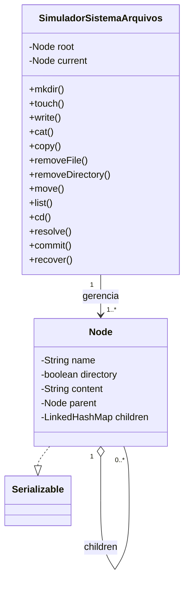
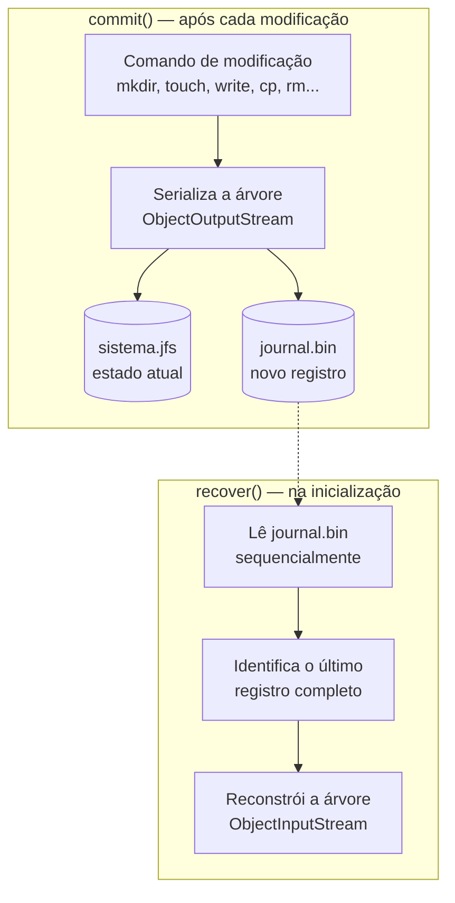
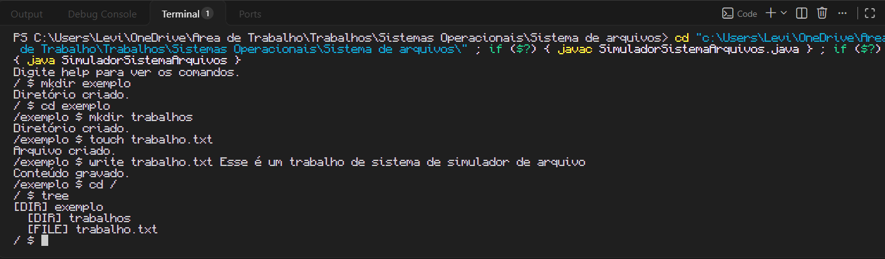

# 🗂️ Simulador de Sistema de Arquivos com Journaling


> Simulador de sistema de arquivos em Java, com interface em modo Shell, armazenamento binário e journaling para recuperação dos dados.

**🔗 Repositório no GitHub:** https://github.com/Levi-Cavalcantech/AV3_Projeto_SO.git

**👥 Integrantes:**

- Levi Augusto Cavalcante de Castro | 2410376
- Francisco Antonio de Oliveira Neto | 2418542

**📚 Disciplina:** Sistemas Operacionais  
**🏫 Instituição:** Unifor

---

## 📑 Sumário

1. [Resumo](#-resumo)
2. [Introdução](#1-introdução)
3. [Parte 1 — Introdução ao Sistema de Arquivos com Journaling](#2-parte-1--introdução-ao-sistema-de-arquivos-com-journaling)
4. [Parte 2 — Arquitetura do Simulador](#3-parte-2--arquitetura-do-simulador)
5. [Parte 3 — Implementação em Java](#4-parte-3--implementação-em-java)
6. [Parte 4 — Instalação e Funcionamento](#5-parte-4--instalação-e-funcionamento)
7. [Considerações Finais](#6-considerações-finais)
8. [Referências](#7-referências)

---

## 📝 Resumo

Este trabalho apresenta o desenvolvimento de um simulador de sistema de arquivos em Java, com o objetivo de compreender como os sistemas operacionais organizam, armazenam e recuperam arquivos e diretórios. O simulador oferece uma interface em modo Shell, implementa as operações básicas de manipulação de arquivos e diretórios (criar, copiar, apagar, renomear e listar) e utiliza journaling, baseado em snapshots binários, para registrar as alterações e recuperar o último estado válido do sistema após o encerramento da aplicação.

---

## 1. Introdução

Este projeto tem como objetivo desenvolver um simulador de sistema de arquivos utilizando a linguagem Java, permitindo compreender os conceitos fundamentais de organização, manipulação e armazenamento de arquivos e diretórios em sistemas operacionais.

O simulador implementa operações básicas de gerenciamento de arquivos e diretórios, como criação, cópia, exclusão, renomeação e listagem. Além disso, utiliza o conceito de **journaling** para registrar os estados do sistema e possibilitar a recuperação dos dados após o encerramento da aplicação.

O sistema possui uma interface em **modo Shell**, na qual o usuário pode executar comandos e visualizar os resultados das operações realizadas.

### 1.1. Objetivo

Desenvolver um simulador de sistema de arquivos em Java que permita:

- ✅ Criar e manipular arquivos e diretórios.
- ✅ Executar operações de cópia, exclusão e renomeação.
- ✅ Navegar entre diretórios.
- ✅ Listar o conteúdo de diretórios.
- ✅ Armazenar a estrutura do sistema em um arquivo binário.
- ✅ Implementar journaling para registrar alterações e permitir a recuperação do sistema.

### 1.2. Metodologia

O simulador é desenvolvido em **Java**, utilizando conceitos de **orientação a objetos**.

O programa recebe comandos por meio de uma interface Shell, interpreta os parâmetros fornecidos e executa os métodos correspondentes às operações do sistema de arquivos.

As estruturas de dados são mantidas **em memória** durante a execução, enquanto as alterações são armazenadas em **arquivos binários** para garantir a persistência das informações.

O desenvolvimento foi dividido em três etapas principais:

| Etapa | Descrição |
|:-----:|-----------|
| 1 | Implementação das estruturas de dados para representar arquivos e diretórios. |
| 2 | Implementação dos métodos responsáveis pelas operações do sistema de arquivos. |
| 3 | Implementação do armazenamento binário e do journaling para recuperação dos dados. |

---

## 2. Parte 1 — Introdução ao Sistema de Arquivos com Journaling

### 2.1. Descrição do Sistema de Arquivos

Um **sistema de arquivos** é um componente de um sistema operacional responsável por organizar, armazenar, localizar e gerenciar arquivos e diretórios em dispositivos de armazenamento.

Ele define como os dados são organizados e como as informações sobre arquivos (nomes, localização, tamanho e estrutura hierárquica) são armazenadas. Graças a ele, o usuário pode manipular seus dados por meio de operações como criação, leitura, escrita, cópia, renomeação e exclusão.

Entre os sistemas de arquivos utilizados atualmente, destacam-se **NTFS, FAT32, exFAT, ext4 e APFS**.

No simulador desenvolvido, a estrutura do sistema de arquivos é representada por uma **árvore de diretórios e arquivos**, o que ajuda a compreender como os sistemas operacionais organizam seus dados.

### 2.2. Conceito de Journaling

**Journaling** é uma técnica utilizada em sistemas de arquivos para registrar alterações antes ou durante sua aplicação ao armazenamento.

Seu principal objetivo é reduzir o risco de inconsistências em situações como:

- ⚡ falhas de energia;
- 🔌 encerramentos inesperados;
- ✍️ interrupções durante operações de escrita.

O *journal* funciona como um registro das alterações realizadas no sistema. Dependendo da implementação, ele pode armazenar operações ou dados que permitam reconstruir um estado consistente após uma falha.

### 2.3. Funcionamento do Journaling

Em uma implementação baseada em registro de operações, o processo pode ocorrer da seguinte forma:


No simulador desenvolvido, o journaling é implementado por meio do **armazenamento de estados binários completos** do sistema de arquivos:

- Após cada operação de modificação bem-sucedida, o estado atualizado é **serializado** e registrado no arquivo de journal.
- Durante a inicialização, o simulador percorre os registros do journal e **recupera o último estado válido**.

### 2.4. Tipos de Journaling

Existem diferentes abordagens para implementar journaling em sistemas de arquivos:

| Tipo | Descrição |
|------|-----------|
| **Write-Ahead Logging (WAL)** | Registra as alterações no log *antes* de aplicá-las definitivamente ao armazenamento principal. O log pode ser usado para recuperar operações confirmadas ou desfazer alterações incompletas. |
| **Log-Structured File System (LFS)** | Armazena as modificações do sistema de arquivos de forma sequencial em um log, reduzindo a necessidade de atualizar dados em posições dispersas do dispositivo. |
| **Journaling de metadados** | Registra principalmente alterações nas informações estruturais, como diretórios, permissões e localização dos arquivos. |
| **Journaling de dados** | Registra tanto as alterações nos metadados quanto o conteúdo dos arquivos, oferecendo maior proteção contra inconsistências. |

> 💡 **Nota:** o simulador utiliza uma abordagem didática baseada em **registros binários de estados completos (snapshots)**. Portanto, sua implementação não corresponde integralmente a um sistema WAL ou LFS, mas demonstra o princípio de registrar alterações para possibilitar a recuperação do sistema.

---

## 3. Parte 2 — Arquitetura do Simulador

### 3.1. Estrutura de Dados

O sistema de arquivos é representado por uma **estrutura hierárquica em árvore**. Cada elemento é representado pela classe `Node`, responsável por armazenar as informações de arquivos e diretórios.

| Atributo | Descrição |
|----------|-----------|
| `name` | Nome do arquivo ou diretório. |
| `directory` | Indica se o elemento é um diretório. |
| `content` | Armazena o conteúdo textual de um arquivo. |
| `parent` | Referência para o diretório pai. |
| `children` | Coleção de arquivos e subdiretórios. |

A estrutura utiliza um **`LinkedHashMap`** para armazenar os elementos de cada diretório, permitindo sua identificação pelo nome e preservando a ordem de inserção.

O **diretório raiz** (`/`) representa o início da árvore e é utilizado como referência para os caminhos absolutos.



### 3.2. Representação Hierárquica

```text
/
├── documentos/
│   ├── trabalho.txt
│   └── faculdade/
│       └── sistemas.txt
└── imagens/
    └── foto.txt
```

Cada diretório pode possuir arquivos e outros diretórios, permitindo a construção de estruturas hierárquicas semelhantes às encontradas em sistemas operacionais reais.

### 3.3. Armazenamento Binário

O simulador utiliza dois arquivos principais:

| Arquivo | Função |
|---------|--------|
| `sistema.jfs` | Armazena a estrutura **atual** do sistema de arquivos em formato binário. |
| `journal.bin` | Armazena os **registros binários** dos estados do sistema após as modificações. |

- A serialização binária é realizada por meio das classes `ObjectOutputStream` e `ObjectInputStream`.
- O arquivo principal contém a representação serializada da estrutura de arquivos e diretórios.
- O journal utiliza `DataOutputStream` para registrar o **tamanho** de cada estado e os respectivos **bytes**, permitindo a leitura sequencial dos registros.

Dessa forma, os arquivos não são armazenados em formato textual legível por editores convencionais, como o Notepad++.

### 3.4. Implementação do Journaling

O journaling é implementado por meio do método `commit()`. Após uma operação de modificação, o sistema:

1. Serializa a estrutura atual do sistema de arquivos.
2. Grava o estado atualizado em `sistema.jfs`.
3. Acrescenta um registro binário ao arquivo `journal.bin`.

Durante a inicialização, o método `recover()` percorre o journal e identifica o **último registro completo**. Esse registro é utilizado para reconstruir a estrutura do sistema de arquivos, permitindo a recuperação dos dados após o encerramento da aplicação.



**Estrutura de cada registro do journal:**

```text
┌────────────────────┬───────────────────────────────────┐
│  Tamanho (int)     │  Bytes do estado serializado      │
│  DataOutputStream  │  (árvore completa do sistema)     │
└────────────────────┴───────────────────────────────────┘
```

O simulador utiliza, portanto, uma abordagem baseada em **snapshots binários**, em que cada registro representa um estado completo do sistema.

---

## 4. Parte 3 — Implementação em Java

### 4.1. Classe `SimuladorSistemaArquivos`

Responsável pelo funcionamento geral do simulador. Ela contém os métodos que interpretam os comandos do Shell, manipulam os arquivos e diretórios virtuais, armazenam os dados e recuperam o sistema.

| Método | Funcionalidade |
|--------|----------------|
| `mkdir()` | Cria um diretório. |
| `touch()` | Cria um arquivo vazio. |
| `write()` | Grava conteúdo em um arquivo. |
| `cat()` | Exibe o conteúdo de um arquivo. |
| `copy()` | Copia um arquivo. |
| `removeFile()` | Apaga um arquivo. |
| `removeDirectory()` | Apaga um diretório. |
| `move()` | Renomeia ou move um arquivo ou diretório. |
| `list()` | Lista o conteúdo de um diretório. |
| `cd()` | Altera o diretório atual. |
| `resolve()` | Localiza arquivos e diretórios a partir de seus caminhos. |
| `commit()` | Grava o estado atual do sistema e o registra no journal. |
| `recover()` | Recupera o último estado válido do journal. |

### 4.2. Classe `Node`

Representa os **arquivos e diretórios** do sistema. Cada objeto pode ser um arquivo ou um diretório, diferenciados pelo atributo `directory`.

- Os **arquivos** possuem conteúdo textual.
- Os **diretórios** possuem uma coleção de elementos filhos.
- A classe implementa `Serializable`, permitindo que seus objetos sejam convertidos em uma sequência de bytes para armazenamento binário.

### 4.3. Classe `Journal`

A implementação do journal está **integrada à classe principal** do simulador. Os métodos `commit()` e `recover()` são responsáveis pelo registro e pela recuperação dos estados binários.

O journal é composto por registros sequenciais, cada um contendo:

- O **tamanho** do estado armazenado.
- Os **bytes** correspondentes à estrutura serializada do sistema de arquivos.

Essa organização permite identificar os limites dos registros e recuperar o último estado completo.

### 4.4. Operações Disponíveis

| Comando | Descrição |
|---------|-----------|
| `mkdir` | Cria diretórios. |
| `touch` | Cria arquivos vazios. |
| `write` | Grava conteúdo em arquivos. |
| `cat` | Exibe o conteúdo de arquivos. |
| `cp` | Copia arquivos. |
| `rm` | Apaga arquivos. |
| `rmdir` | Apaga diretórios e seus conteúdos. |
| `mv` | Renomeia ou move arquivos e diretórios. |
| `ls` | Lista o conteúdo de diretórios. |
| `cd` | Navega entre diretórios. |
| `pwd` | Exibe o caminho atual. |
| `tree` | Exibe a estrutura hierárquica do sistema. |

---

## 5. Parte 4 — Instalação e Funcionamento

### 5.1. Recursos Utilizados

- ☕ **Java Development Kit (JDK)**
- 💻 IDE ou editor de código, como IntelliJ IDEA, Eclipse ou Visual Studio Code
- ⌨️ Terminal ou prompt de comando
- 🐙 Git e GitHub para versionamento e disponibilização do projeto

> O projeto utiliza **apenas bibliotecas padrão do Java**. Não é necessária a instalação de dependências externas.

### 5.2. Clonagem do Projeto

```bash
git clone URL_DO_REPOSITORIO
cd NOME_DO_PROJETO
```

Substitua `URL_DO_REPOSITORIO` pelo endereço do repositório no GitHub e `NOME_DO_PROJETO` pelo nome da pasta criada.

### 5.3. Compilação

```bash
javac SimuladorSistemaArquivos.java
```

Esse comando compila o código-fonte e gera o arquivo `.class` necessário para a execução.

### 5.4. Execução

```bash
java SimuladorSistemaArquivos
```

O simulador será iniciado em modo Shell, permitindo a execução dos comandos disponíveis.

### 5.5. Exemplo de Utilização

```text
$ mkdir documentos
$ cd documentos
$ mkdir faculdade
$ touch trabalho.txt
$ write trabalho.txt Sistema de arquivos em Java
$ cat trabalho.txt
Sistema de arquivos em Java
$ cd /
$ tree
```

Saída esperada do comando `tree`:

```text
[DIR] documentos
  [DIR] faculdade
  [FILE] trabalho.txt
```

> 📸 *Sugestão: inclua aqui um print da execução do simulador no terminal.*
>
> 

### 5.6. Persistência e Recuperação

Após executar operações de modificação, o sistema atualiza os arquivos binários `sistema.jfs` e `journal.bin`.

Ao encerrar o simulador e executá-lo novamente, a estrutura de arquivos e diretórios é **recuperada automaticamente** a partir do último estado válido registrado no journal.

**Como testar a persistência:**

1. Execute o simulador e crie alguns arquivos e diretórios.
2. Encerre o programa.
3. Execute o simulador novamente e use `tree` para conferir que tudo foi recuperado.

### 5.7. Verificação dos Arquivos Binários

Os arquivos `sistema.jfs` e `journal.bin` podem ser abertos em um **editor hexadecimal** ou no **Notepad++**.

Como os dados são armazenados em formato binário, o conteúdo não será apresentado como uma sequência de comandos legíveis. Isso demonstra que o simulador utiliza armazenamento binário para representar a estrutura do sistema de arquivos e seu journal.

> ⚠️ **Atenção:** não edite nem salve manualmente esses arquivos em editores de texto, pois isso pode corromper os dados armazenados.

---

## 6. Considerações Finais

O desenvolvimento do simulador permite compreender os conceitos fundamentais de sistemas de arquivos, estruturas hierárquicas, manipulação de arquivos e persistência de dados.

A implementação do journaling demonstra como o registro de estados pode ser utilizado para recuperar informações após o encerramento da aplicação.

O projeto também possibilita aplicar conceitos de orientação a objetos, serialização binária, manipulação de arquivos e interpretação de comandos em Java.

**Melhorias futuras:**

- Mecanismos de recuperação transacional mais robustos.
- Validação de integridade dos registros (por exemplo, checksum).
- Armazenamento de arquivos em blocos.
- Suporte a permissões de acesso.

---

## 7. Referências

- SILBERSCHATZ, Abraham; GALVIN, Peter B.; GAGNE, Greg. **Fundamentos de Sistemas Operacionais**.
- TANENBAUM, Andrew S.; BOS, Herbert. **Sistemas Operacionais Modernos**.
- Documentação oficial Java: <https://docs.oracle.com/en/java/>

---
